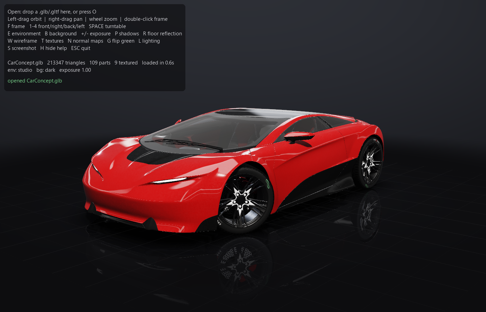
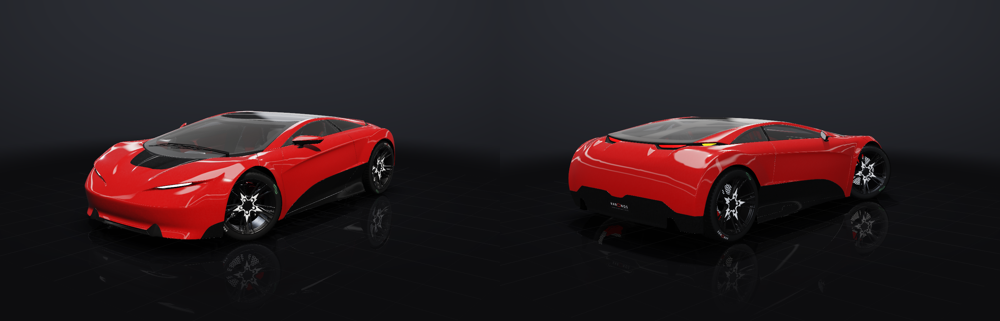
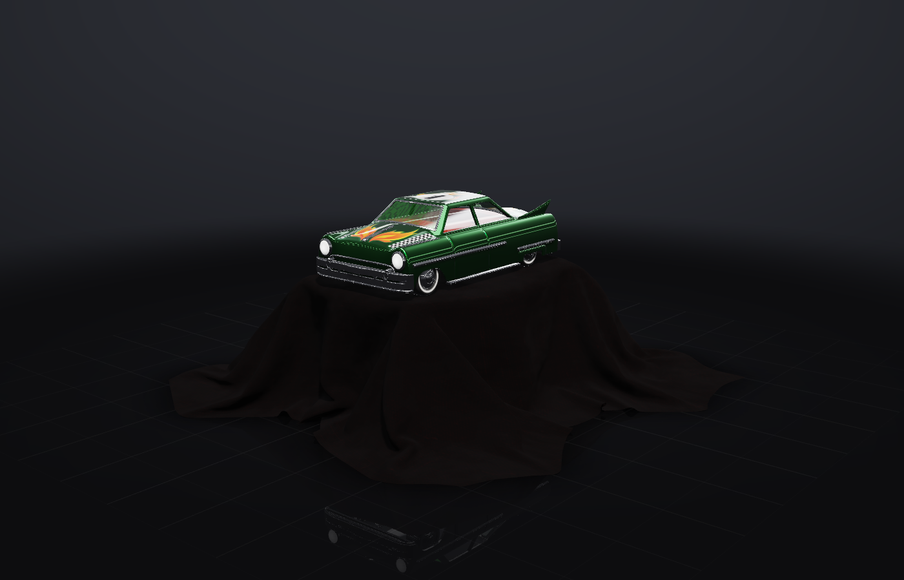
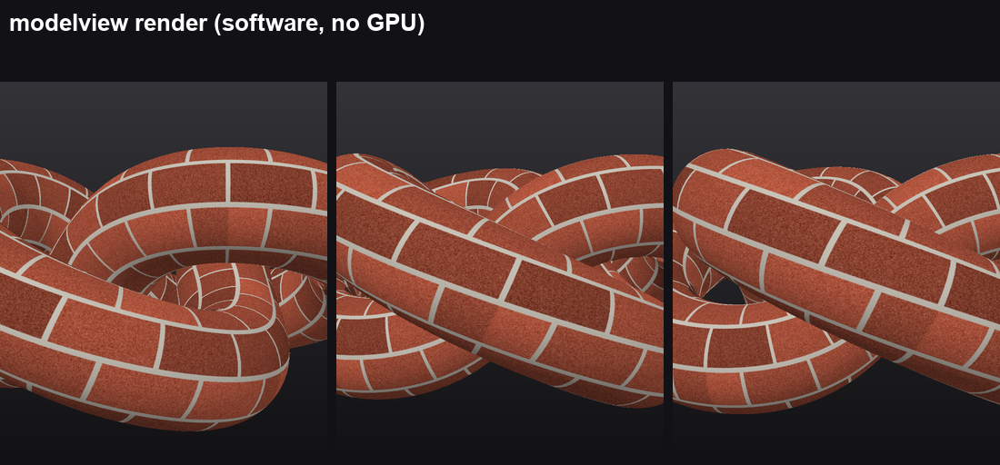

# modelview

A fast, simple 3D model viewer for Windows. Open a `.glb` / `.gltf` model and spin it around in real time with
physically based materials, studio reflections, soft shadows and a glossy showroom floor. Compare texture sets, save
screenshots. One `.exe`, nothing to install.





<sub>Car Concept © 2024 Darmstadt Graphics Group GmbH, model by Eric Chadwick, CC BY 4.0 — see [CREDITS.md](CREDITS.md).</sub>



<sub>Toy Car by Guido Odendahl and Eric Chadwick, CC0 — see [CREDITS.md](CREDITS.md).</sub>

## Download

### [⬇ Download modelview.exe](https://github.com/RashestLynx/3D-Renderer/raw/main/release/modelview.exe) (Windows, 33 MB)

No install: double-click it. Windows SmartScreen may warn about an unsigned app the first time — choose
*More info → Run anyway*.

## Get started


- double-click `modelview.exe` and **drag a model onto the window**, or press **O** to browse, or
- drag a `.glb` **onto `modelview.exe`** itself, or right-click a `.glb` → *Open with* → `modelview.exe`.

Try `examples/khronos/CarConcept.glb`, `examples/khronos/ToyCar.glb` or `examples/demo.glb`.

## Controls

| Mouse | |
|---|---|
| Left-drag | Orbit (flick it and it keeps turning for a moment) |
| Right-drag / middle-drag / Shift+left-drag | Pan |
| Wheel | Zoom |
| Double-click | Re-frame the model |

| Key | | Key | |
|---|---|---|---|
| **O** | Open a model | **E** | Lighting environment (studio / overcast / night / white) |
| **F** | Frame the model | **B** | Background (environment / dark / grey / black / white) |
| **1 2 3 4** | Front / right / back / left | **+ / −** | Exposure |
| **Space** | Turntable spin | **P** | Shadows on/off |
| **S** | Screenshot → `Pictures\modelview` | **R** | Reflective floor on/off |
| **H** / **F1** | Hide / show help | **W** | Wireframe |
| **Esc** | Quit | **T** / **N** / **L** | Textures / normal maps / lighting on/off |
| | | **G** | Flip normal-map green (DirectX ↔ OpenGL maps) |

Camera moves glide instead of jumping, and the window redraws at your monitor's refresh rate (about 150 fps for the
213k-triangle Car Concept with every effect on, on an RTX 3060 laptop).

Drop a **texture map** (`.json`, below) on the window to re-texture the open model.

## What it renders

- glTF 2.0 binary (`.glb`) and text (`.gltf`, external or embedded buffers and images), skinned models in bind pose
- Metallic-roughness PBR: base colour, normal, metallic/roughness, emissive and occlusion maps, `KHR_texture_transform`
- Car paint and glass: `KHR_materials_clearcoat` (a smooth lacquer over flaked paint), `KHR_materials_transmission`,
  `KHR_materials_emissive_strength`; alpha cut-outs (hair, leaves) and blended parts sorted back to front
- A procedural car-photo studio for reflections (overhead softbox, long strip lights), ACES tone mapping
- Shadow-mapped key light, a soft contact shadow under the model, and a glossy floor with a fading reflection
- 4× MSAA, mip-mapped anisotropic textures, and filtering that keeps fine bump detail from sparkling

If the PC has no OpenGL 3.3, the exe falls back to a slower software-rendered window.

## Texture maps

A texture map swaps or supplies textures per material without touching the model — for models whose images live in
another folder, or to compare an original texture set with an upscaled one:

```json
{
  "body_material": "C:/textures/body_upscaled.png",
  "head_material": {"color": "C:/textures/head.png", "normal": "C:/textures/head_n.png"},
  "eye_glass": ""
}
```

An empty value hides that material (clear shells such as glass that would otherwise draw solid).

## Command line

The same exe (or `python -m modelview`) renders images without opening a window — software rendering, no GPU needed:

```bat
modelview.exe render  model.glb -o sheet.png --views 0,45,180 --closeup
modelview.exe compare model.glb -o compare.png --a original.json --b upscaled.json --labels "Original,Upscaled"
```



Options: `--views` camera angles in degrees, `--size 560x860`, `--pitch`, `--zoom`, `--closeup` (adds a close-up of
the top of the model, e.g. a character's head), `--title`.

## As a Python library

```python
from modelview import load, render, Camera
model = load('model.glb', {'body_material': 'body.png'})
render(model, Camera(yaw=30, pitch=10), size=(800, 1000)).save('out.png')
```

## Build from source

To build the exe yourself instead of downloading it:

```bat
pip install -r requirements.txt pyinstaller
build.bat                       :: -> dist\modelview.exe
python app.py examples\demo.glb :: or run without building
python -m pytest tests          :: tests (pip install pytest)
```

Requires Python 3.9+, numpy, Pillow, moderngl and pyglet.

## Credits

The example cars are by Eric Chadwick, Guido Odendahl and the Khronos Group (Car Concept under CC BY 4.0, Toy Car
under CC0). Full credits and licences: [CREDITS.md](CREDITS.md).
